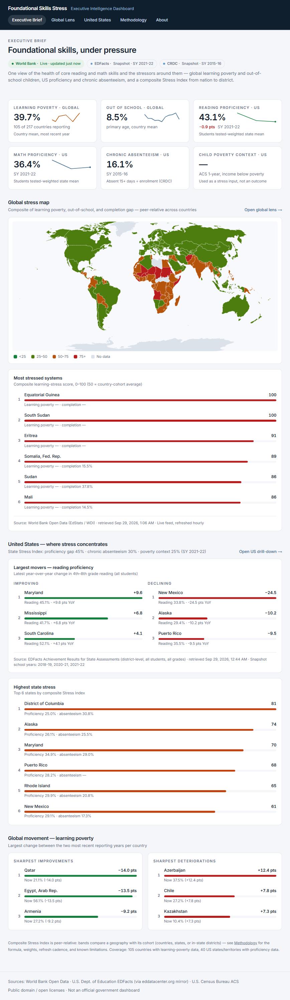
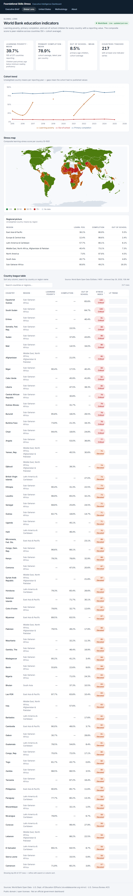
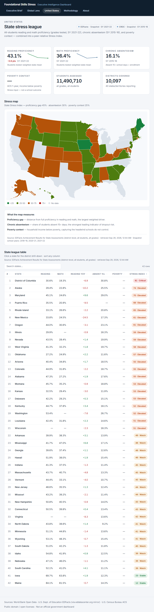
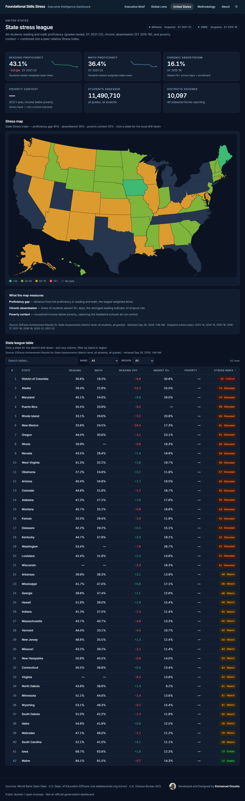
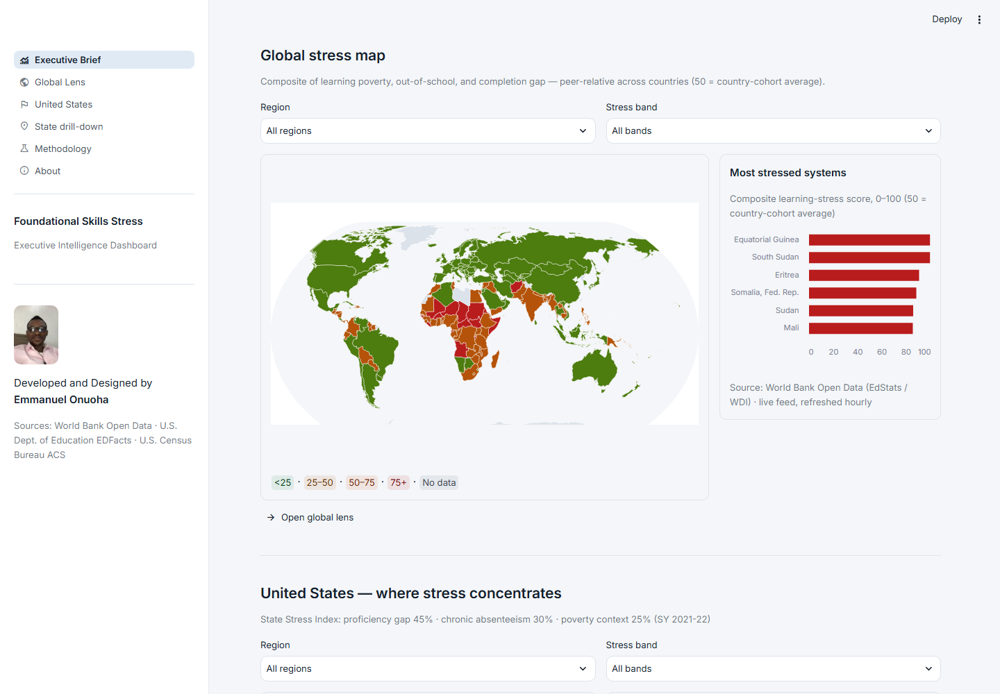
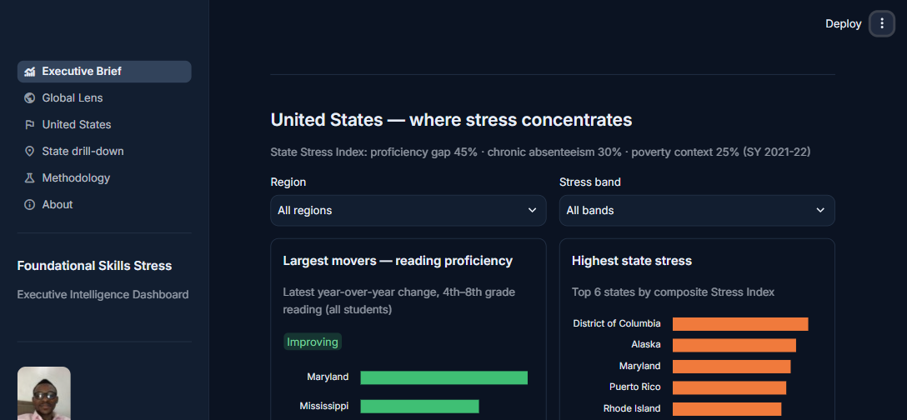

# Foundational Skills Stress — Executive Dashboard

[](https://github.com/Emmydutch/foundational-skills-stress/actions/workflows/ci.yml)
[](https://nextjs.org)
[](https://streamlit.io)
[](LICENSE)

An executive-grade view of the health of foundational skills — reading and math proficiency, chronic absenteeism, and the stressors around them — with a single composite **Stress Index** computed the same way at every level:

**Global (World Bank) → US national → state → district**

All data comes from public, verifiable sources. Every panel shows its source, vintage, and freshness state.

**Two editions, one dashboard:** a **Next.js web app** (`src/`, deploys to Vercel) and a **Streamlit app** (`streamlit_app/`, for Python environments). Both read the same committed snapshots, compute the same stress index, and expose the same filters, drill-downs, and freshness chips.

**Live:** Next.js edition on Vercel → [foundational-skills-stress.vercel.app](https://foundational-skills-stress.vercel.app)

---

## Screenshots

**Next.js edition** — executive brief, global lens, US state league, and state drill-down in dark mode.
**Streamlit edition** — the same executive brief in light and dark themes.

| | |
| --- | --- |
|  |  |
|  |  |
|  |  |

---

## Quick start

```bash
npm install
npm run ingest        # build the US snapshots (streams ~2.2GB of federal files; resume-safe)
npm run dev           # http://localhost:3000
```

The normalized snapshots in `data/snapshots/` ship with the repository, so `npm run dev` renders a complete dashboard immediately — `npm run ingest` is only needed to **refresh** the US layer when upstream releases update.

No secrets are required, but some networks are denied keyless access to the Census API (a "Missing Key" page): set a free `CENSUS_API_KEY` to enable the poverty context feed there. The dashboard degrades cleanly without it (poverty shows "—" and the stress-index weights renormalize).

### Streamlit edition

The Streamlit app reads the same `data/snapshots/` — no keys, no network needed for the committed layers.

```bash
python -m venv .venv
.venv\Scripts\pip install -r streamlit_app/requirements.txt   # Windows; .venv/bin/pip on macOS/Linux
.venv\Scripts\streamlit run streamlit_app/app.py              # http://localhost:8501
```

Headless smoke test (boots the real entrypoint and visits every page):

```bash
.venv\Scripts\python streamlit_app/smoke_test.py
```

## Scripts

| Script | What it does |
| --- | --- |
| `npm run dev` | Start the dashboard (all fetching is server-side). |
| `npm run build` / `start` | Production build and serve. |
| `npm run ingest` | Rebuild **all** US snapshots (achievement + absenteeism). Streams large files; resume-safe. |
| `npm run ingest:achievement` | Refresh just the EDFacts reading/math snapshots. |
| `npm run ingest:absenteeism` | Refresh the CRDC chronic-absenteeism snapshot. |
| `npm run verify-feeds` | **First troubleshooting step** — smoke-tests every endpoint (status + shape) plus local snapshots. |
| `npm test` | Vitest unit tests for the stress-index math. |

## Data sources

| Layer | Source | Mode | Cadence |
| --- | --- | --- | --- |
| Global | [World Bank Open Data](https://data.worldbank.org) — learning poverty `SE.LPV.PRIM`, primary completion `SE.PRM.CUAT.ZS`, out-of-school `SE.PRM.UNER.ZS` | Live API | Revalidated hourly |
| US proficiency | EDFacts achievement (U.S. Dept. of Education), streamed from the [eddatacenter.org](https://www.eddatacenter.org) mirror of the federal exports — district files back to 2013-14, latest release SY 2021-22 | Snapshot | Annual (ESSA assessments; SY 2019-20 was federally waived) |
| US absenteeism | [CRDC 2015-16](https://civilrightsdata.ed.gov) chronic-absenteeism counts ÷ same-year CRDC enrollment | Snapshot | Biennial collection |
| US context | [U.S. Census Bureau ACS 1-year](https://data.census.gov) (B17001 poverty), state level | Live API | Revalidated daily |
| US fallback | [Urban Institute Education Data API](https://educationdata.urban.org) adapter — opportunistic only; some networks block the host, so there is no hard dependency | Live API | On request |

**Licenses:** World Bank data is [CC BY 4.0](https://datacatalog.worldbank.org/public-licenses#cc-by); EDFacts, CRDC, and Census data are US federal public-domain products. Attribute the originating agencies, not this dashboard.

## Architecture

```
                     BUILD TIME                              REQUEST TIME
┌─────────────────────────────────────────┐   ┌──────────────────────────────────────┐
│ npm run ingest                          │   │ Next.js App Router (server-side)     │
│                                         │   │                                      │
│ data.ed.gov portal API ──discover──┐    │   │  /            executive brief        │
│ GCS mirror (eddatacenter.org) ─────┤    │   │  /global      World Bank lens        │
│   EDFacts state/district CSVs      ├─►  │   │  /us          state league           │
│   (streamed, filtered, resume-safe)│    │   │  /us/[state]/[district]              │
│ CRDC absenteeism + enrollment ─────┘    │   │  /methodology /about                 │
│   (xlsx → rates)                        │   │                                      │
│              │                          │   │  ┌───────────────┐                   │
│              ▼                          │   │  │ World Bank API │  (live, hourly)  │
│  data/snapshots/*.json  ────────────────┼──►│  │ Census ACS API │  (live, daily)   │
│  (compact, committed)                   │   │  └───────────────┘                   │
└─────────────────────────────────────────┘   │  stress index computed per request   │
                                              └──────────────────────────────────────┘
```

The ingest never stores the raw 140MB+ files — it streams them, keeps only all-students/all-grades rows, resolves censored ranges (e.g. `<=5%`, `20-24%`) to midpoints, and writes compact JSON. A network reset mid-stream resumes at the last completed byte offset instead of restarting.

## The Stress Index

Three peer-relative z-scored components combine into a 0–100 score (`50 + 15·z`, clamped):

- **Proficiency gap — 45%** (100 minus average reading/math proficiency)
- **Chronic absenteeism — 30%** (share of students missing 15+ days)
- **Poverty context — 25%** (ACS poverty rate)

Missing components are dropped and the remaining weights renormalize. Bands: **Stable** < 25, **Watch** 25–49, **Elevated** 50–74, **Critical** 75+.

Districts are z-scored against **in-state** peers because proficiency is state-defined under ESSA — see `/methodology` for the full formula, refresh cadence per feed, and known limitations. The math lives in `src/lib/stress-index.ts` with unit tests.

## Reliability & freshness contract

- Every panel carries a freshness chip: **Live** (green, with relative time), **Snapshot** (neutral, with school year), or **Last good data** (amber) when a live feed failed and cached data is being served.
- Server-side fetches use revalidation windows (World Bank hourly, Census daily); a failed revalidation serves the last good copy — the dashboard never renders an empty panel.
- Forced-failure demos: `STRESS_FAIL_FEEDS=global,us,census npm run dev` makes the degraded states render deliberately.
- `npm run verify-feeds` distinguishes `FAIL` (critical) from `WARN` (optional, e.g. the blocked Urban host).

## Environment variables

| Variable | Required | Purpose |
| --- | --- | --- |
| `CENSUS_API_KEY` | No (recommended) | Free key from api.census.gov. Some networks are denied keyless access; the poverty feed needs the key there. |
| `STRESS_FAIL_FEEDS` | No | Dev-only. Comma list of `global`, `us`, `census` to force degraded states. |

## Project structure

```
scripts/            ingest.mjs, ingest-absenteeism.mjs, verify-feeds.mjs, state-ref.mjs
data/snapshots/     committed JSON snapshots both editions serve
data/raw/           transient downloads (gitignored)
src/app/            routes: /, /global, /us, /us/[state], /us/[state]/[district], /methodology, /about
src/components/     KPI cards, freshness chips, stress badge/gauge, charts, maps, comparator
src/lib/            stress-index.ts, us-metrics.ts, global-metrics.ts, feeds/, data/
streamlit_app/      Streamlit edition: app.py entry, app_pages/ (6 pages), lib/ (shared logic), assets/
```

## Deployment

### Next.js edition — Vercel

Deploys with zero configuration and no secrets (the Census key is optional). Snapshots are committed, so a fresh deploy renders fully even before any live fetch succeeds; live feeds refresh server-side after deploy.

Live: [foundational-skills-stress.vercel.app](https://foundational-skills-stress.vercel.app)

### Streamlit edition — Streamlit Community Cloud

The Streamlit app ships with everything the cloud runtime needs: the snapshots it reads are committed, the data paths resolve from the app's own file location, and no secrets are required.

1. Push this repository to GitHub (branch `main`).
2. Sign in at [share.streamlit.io](https://share.streamlit.io) with GitHub and click **Create app** → **Deploy a public app from GitHub**.
3. Repository: this repo · Branch: `main` · **Main file path:** `streamlit_app/app.py`.
4. Under **Advanced settings**, set **Python dependencies** to `streamlit_app/requirements.txt` (Python 3.12).
5. Deploy. The build takes a couple of minutes and serves `https://<app-name>.streamlit.app`.

Later refreshes: push to `main` — Streamlit Cloud redeploys automatically.

### Continuous integration

`.github/workflows/ci.yml` runs on every push and pull request: Node 22 (lint → Vitest → production build) and Python 3.12 (Streamlit headless smoke test across all six pages).

## Troubleshooting

1. **A panel is empty or stale** → run `npm run verify-feeds`; the failing line names the layer.
2. **US snapshot missing** → `npm run ingest` (network is flaky on large streams; the ingester resumes where it left off — just re-run it).
3. **Poverty shows "—"** → the Census gateway denied keyless access from this network; set `CENSUS_API_KEY` (free) and restart. The dashboard is designed to run without it.
4. **Global page degraded** → the World Bank host was unreachable at revalidation time; it self-recovers, or diagnose with `verify-feeds`.
5. **Urban adapter warning** → expected on networks that block `educationdata.urban.org`; the app falls back to EDFacts snapshots by design.

## Credits

**Developed and Designed by Emmanuel Onuoha.**

The stress-index design, both application editions (Next.js and Streamlit), and the visual system are original work. The underlying data belongs to the public agencies credited above — see [Data sources](#data-sources) for licenses.

## Disclaimer

Independent analytics product — not an official dashboard of the U.S. Department of Education, the U.S. Census Bureau, or the World Bank. Data vintages vary by source and are always shown on the panel they feed.
